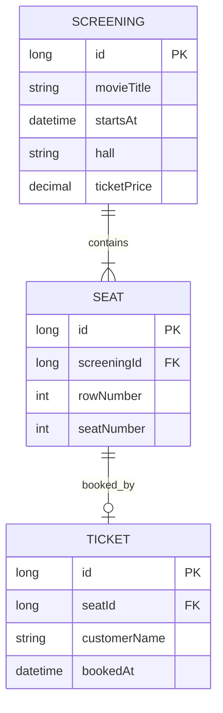

# Cinema Booking — система бронювання квитків у кінотеатрі

> Навчальний Spring Boot застосунок для лабораторних робіт №2–6.
> **Варіант №6 із методички ЛР №2.** Мета — невеликий, зрозумілий, робочий проєкт, який виконує вимоги лабораторних **без зайвих функцій**.

## 1. Тема й межі проєкту

**Завдання варіанта №6:**

- **Сутності за методичкою:** сеанс, місце.
- **Актори:** гість, адміністратор.
- **Гість:** переглядає сеанси, замовляє квитки.
- **Адміністратор:** створює, редагує та видаляє інформацію про сеанси й квитки.

Для оформлення замовлення вводимо **квиток** як третю просту модель. Не створюємо окремих сутностей `Movie`, `User`, `Payment`, `CinemaHall`, `Order`, `Role` тощо: для цієї навчальної задачі вони не потрібні.

### MVP: що вміє застосунок

1. Показує список сеансів (фільм, час, зал, ціна).
2. Показує місця конкретного сеансу та їхню зайнятість.
3. Дозволяє гостю забронювати вільне місце, вказавши ім'я.
4. Не дозволяє забронювати одне місце двічі.
5. Дозволяє адміністратору керувати сеансами та квитками через прості сторінки.
6. Має REST API для сеансів із можливостями, потрібними ЛР №4.
7. Поступово замінює сховище: **in-memory (№2–4) → JDBC (№5) → JPA (№6)**.

**Не робимо:** реєстрацію, авторизацію, оплату, QR-коди, email/SMS, особисті кабінети, ролі в БД, інтерактивну карту залу на JavaScript, мікросервіси, Docker/Kubernetes як обов'язкову частину, складний frontend. Сторінки `/admin/**` — навчальні, **без захисту доступу**; у ЛР №3–4 це дозволено методичками. Не називати таке рішення готовим до production.

## 2. Моделі даних

| Модель | Основні поля | Призначення |
|---|---|---|
| `Screening` | `id`, `movieTitle`, `startsAt`, `hall`, `ticketPrice` | Сеанс конкретного фільму |
| `Seat` | `id`, `screeningId`, `rowNumber`, `seatNumber` | Місце **в конкретному сеансі** |
| `Ticket` | `id`, `seatId`, `customerName`, `bookedAt` | Бронювання одного місця |

**Домовленості:**

- При створенні сеансу автоматично створюємо місця за **фіксованою схемою 3 ряди × 5 місць = 15 місць**. Конструктор або сервіс створює їх один раз; окремий редактор залів не потрібен.
- Місце вільне, якщо для його `seatId` **немає** квитка. Не зберігати паралельно `Seat.booked`: це зайве дублювання стану.
- **Один квиток на одне місце.** Перевіряємо в сервісі, а після переходу на БД додатково забезпечуємо `UNIQUE(ticket.seat_id)`.
- Бронювання перевіряє існування місця й сеансу. За потреби можна заборонити бронювання сеансів у минулому.
- Ціна — `BigDecimal`, дата й час — `LocalDateTime`. Для MVC та REST вхідні дані перевіряємо через Jakarta Validation.
- Редагування квитка адміністратором для MVP означає зміну `customerName`; скасування бронювання — видалення квитка. Перенесення квитків між місцями не реалізуємо.
- Видалення сеансу повинно також коректно прибирати пов'язані місця та квитки (у Fake — явно; у JDBC/JPA — через визначені відношення/каскади або транзакцію).

### Простий зв'язок сутностей



## 3. Технології та структура

**База:** Java 21+ (рекомендовано однакова версія JDK у команді), Spring Boot, Maven, Spring Web, Thymeleaf, Jakarta Bean Validation, JUnit 5. Для №4 додати springdoc-openapi; для №5 — Spring JDBC та PostgreSQL; для №6 — Spring Data JPA. Lombok — необов'язковий: домовитися про стиль один раз і не витрачати час на переписування.

```text
src/main/java/ua/kpi/cinema/
├── CinemaApplication.java
├── model/                 Screening, Seat, Ticket
├── repository/            ScreeningRepository, SeatRepository, TicketRepository
│   └── memory/            InMemory...Repository (ЛР 2–4)
├── service/               ScreeningService, TicketService
├── controller/            MVC-контролери (ЛР 2–3)
├── api/                   REST-контролер, request/response DTO (ЛР 4)
├── config/                Spring-конфігурація + демонстрація DI/scopes
└── exception/             Зрозумілі помилки + HTTP-обробник

src/main/resources/
├── templates/             HTML + Thymeleaf
└── application.properties

src/test/java/ua/kpi/cinema/
docs/
├── lab-2/                 скриншоти, короткі пояснення
├── lab-3/
├── lab-4/
├── lab-5/
└── lab-6/
```

**Архітектура:** `MVC / REST Controller → Service → Repository interface → реалізація`. Контролери **не працюють з репозиторіями напряму**; одна бізнес-логіка використовується HTML і REST. Без зайвих factory/strategy/mapper-шарів, якщо це не потрібно.

## 4. Розподіл між 5 учасниками

**Один учасник — одна лабораторна.** ЛР №2–6 = п'ять послідовних етапів одного проєкту. Імена впишіть у таблицю, коли домовитеся.

| Учасник | Відповідальність | Що передає наступному |
|---|---|---|
| 1 — ______ | **ЛР №2**: каркас, моделі, Fake Repository, сервіси, мінімальний MVC, DI | Робочий застосунок і стабільні моделі/сервісні методи |
| 2 — ______ | **ЛР №3**: Thymeleaf-сторінки, форми, XSS, MVC-сценарії | Готовий HTML-інтерфейс поверх існуючих сервісів |
| 3 — ______ | **ЛР №4**: REST, CRUD, фільтрація, пагінація, 2 PATCH, OpenAPI, Postman | Робочий API + приклади запитів |
| 4 — ______ | **ЛР №5**: PostgreSQL, JDBC, транзакції | JDBC-сховище замість Fake без зміни поведінки сервісів |
| 5 — ______ | **ЛР №6**: Spring Data JPA, зв'язки, запити, перевірки | JPA-сховище замість JDBC без зміни зовнішнього API |

> **Важливо:** етапи залежать один від одного, тому це **не п'ять незалежних паралельних проєктів**. Поки наступний учасник чекає на попередній код, він може читати методичку, готувати Postman-сценарії чи звіт, але не створювати несумісний каркас. Кожен захищає лабораторну **індивідуально**, отже всі мають хоча б орієнтуватися в загальному коді.

### Мінімальна передача етапу (без зайвих зустрічей)

Перед передачею наступному учаснику власник лабораторної:

1. Запускає `./mvnw test` і `./mvnw spring-boot:run` (або `mvn`, якщо wrapper не створено).
2. Перевіряє один позитивний і один помилковий сценарій.
3. Робить PR/merge в `main` після короткого review, ставить тег `lab-2`, `lab-3` тощо.
4. У PR пише **3–5 речень**: що зроблено, як запустити, що перевірено, які є відомі обмеження.
5. Кладе скриншоти і матеріали для **одного звіту на лабораторну** в `docs/lab-N/`. У звіті: титул із ПІБ і групами всіх учасників, хід роботи (скриншоти + пояснення), відповіді на контрольні питання. Хто надсилає звіт — узгодити з викладачем.

Жоден агент або Codex **не робить git commit/push без дозволу людини**.

## 5. Лабораторна №2 — Створення та зв'язування компонентів

**Основа проєкту.** Точні вимоги взято з `Spring-lab-02(1).docx`.

### Реалізувати

- [ ] Створити Spring Boot проєкт зі **Spring Web + Thymeleaf**; додати Validation і Test для зручності.
- [ ] Створити `Screening`, `Seat`, `Ticket` і repository-інтерфейси.
- [ ] Створити **Fake Repository** на `Map` із генерацією ID; дані поки тільки в пам'яті.
- [ ] Зробити `ScreeningService`: отримання списку/деталей, створення, редагування, видалення сеансів; автоматичне створення 15 місць.
- [ ] Зробити `TicketService`: бронювання вільного місця, отримання/редагування/скасування квитка; заборона повторної броні.
- [ ] Мінімальні `@Controller` + Thymeleaf: список сеансів і проста форма бронювання (повні сторінки — в №3).
- [ ] Продемонструвати `@Component`, `@Repository`, `@Service`, `@Controller`.
- [ ] Продемонструвати **`@Bean` у `@Configuration`** (наприклад, bean `Clock`).
- [ ] Продемонструвати **singleton і prototype**: стандартний singleton service та невеликий prototype-компонент (наприклад, `BookingDraft`); тестом або демонстрацією довести, що два отримання prototype дають різні екземпляри. Не будувати через це окрему архітектуру.
- [ ] Продемонструвати **три способи DI**: constructor (основний спосіб у сервісах), setter і field (`@Autowired` у невеликих демонстраційних компонентах). Чітко показати ці місця під час захисту.
- [ ] Unit-тести: створення сеансу, бронювання, повторна бронь, відсутній сеанс/місце.

**Критерій готовності:** застосунок запускається, видно сеанси, можна забронювати місце; є конкретні приклади всіх анотацій, двох scopes і трьох DI.

## 6. Лабораторна №3 — Шаблонізатори / MVC

**Розширюємо ЛР №2, не створюємо новий проєкт.** Точні вимоги взято з `Spring-lab-03(1).docx`.

### Реалізувати

- [ ] Сторінка `/screenings`: список сеансів із посиланнями на деталі.
- [ ] Сторінка `/screenings/{id}`: дані сеансу та вільні/зайняті місця.
- [ ] Форма бронювання квитка (`POST`), сторінка підтвердження або повідомлення про помилку.
- [ ] Прості адміністративні сторінки `/admin/screenings` (створення/редагування/видалення) та `/admin/tickets` (список/зміна імені/скасування).
- [ ] У шаблонах **хоча б один раз кожне:** `th:if`, `th:unless`, Elvis `?:`, `th:switch` / `th:case`, `th:each`.
- [ ] XSS: користувацький текст (назва фільму, ім'я покупця) виводити через **`th:text`**, а не `th:utext`; перевірити введення на кшталт `<script>alert(1)</script>`.
- [ ] Просте відображення помилок і серверна валідація форм.
- [ ] **Без Spring Security**: автентифікація й авторизація цією лабораторною не вимагаються.

**Критерій готовності:** увесь основний сценарій працює в браузері; усі Thymeleaf-конструкції є в реальних шаблонах, XSS-рядок не виконується.

## 7. Лабораторна №4 — RESTful вебсервіси

**Той самий проєкт; додаємо REST поруч із MVC.** Точні вимоги взято з `Spring-lab-04(1).docx`.

### Реалізувати

- [ ] `ScreeningRestController` для `/api/screenings`:
  - `POST /api/screenings` — створити (**201**).
  - `GET /api/screenings/{id}` — прочитати (**200 / 404**).
  - `GET /api/screenings` — список із **фільтрацією** (наприклад, `movieTitle`) та **пагінацією** (`page`, `size`).
  - `PUT /api/screenings/{id}` — повністю оновити (**200 / 400 / 404**).
  - `DELETE /api/screenings/{id}` — видалити (**204 / 404**).
- [ ] Два **різні** `PATCH /api/screenings/{id}` за `Content-Type`:
  - `application/json-patch+json` — **JSON Patch, RFC 6902** (масив операцій).
  - `application/merge-patch+json` — **JSON Merge Patch, RFC 7386** (JSON-об'єкт).
  - Використати коректну підтримку цих форматів; **не видавати звичайний частковий PUT за реалізацію обох RFC**. Патчити лише дозволені поля сеансу та валідовувати результат.
- [ ] Правильні HTTP-коди, включно з **400, 404, 409**, де це доречно, та зрозумілі JSON-помилки (`@RestControllerAdvice`).
- [ ] DTO для REST-запитів/відповідей, `@Valid` і Jakarta Validation; не повертати напряму mutable доменні об'єкти, якщо це спричиняє проблеми.
- [ ] **OpenAPI** для **кожної** операції: короткий опис, повний опис, параметри/моделі даних, усі очікувані HTTP-статуси.
- [ ] Перевірити API через **Postman** за документацією: CRUD, фільтри, пагінація, обидва PATCH і помилки; зберегти колекцію/скриншоти.

**Критерій готовності:** REST працює незалежно від HTML-сторінок та використовує **ті самі сервіси**; приклади Postman відповідають OpenAPI.

## 8. Лабораторна №5 — JDBC та PostgreSQL (попередній план)

> **Увага:** точну методичку №5 поки не додано до цього README. Перелік нижче — узгоджений технічний план продовження; перед виконанням звірити обов'язкові пункти з оригінальним завданням.

- [ ] Підключити PostgreSQL і створити таблиці `screenings`, `seats`, `tickets` з PK/FK та `UNIQUE(tickets.seat_id)`.
- [ ] Замінити Fake Repository на JDBC-реалізації, **не змінюючи контролери й бізнес-API сервісів**.
- [ ] Продемонструвати **`JdbcTemplate` і `JdbcClient`** на реальних операціях CRUD / пошуку, якщо цього вимагає методичка.
- [ ] Генеровані базою ID, коректне читання списків і зв'язків.
- [ ] `@Transactional` для створення/видалення сеансу разом із місцями, або іншої складеної операції; перевірити **rollback** на помилці.
- [ ] Тести сховища з реальною тестовою БД / відтворювані SQL-демонстрації.

**Критерій готовності:** після перезапуску застосунку дані зберігаються; сценарії ЛР №2–4 продовжують працювати.

## 9. Лабораторна №6 — Spring Data JPA (попередній план)

> **Увага:** точну методичку №6 ще потрібно звірити. Не сприймати цей список як дослівні вимоги викладача.

- [ ] Перейти з JDBC на Spring Data JPA / Hibernate, не переписуючи MVC та REST.
- [ ] `@Entity`, `@Id`, `@GeneratedValue`, Spring Data `CrudRepository` (або `JpaRepository`, якщо дозволено умовою).
- [ ] Продемонструвати **1:N** на `Screening → Seat`; коректно працювати з квитками.
- [ ] Три способи запитів, якщо вони вимагаються: **derived query method**, JPQL **`@Query`**, **`@NamedQuery`** (наприклад, пошук сеансів за фільмом/часом і квитків певного сеансу).
- [ ] Перевірити транзакції, створення, читання, оновлення, видалення та відсутність подвійного бронювання.
- [ ] Перевірити, що HTML і REST ЛР №2–4 не зламалися після заміни сховища.

**Критерій готовності:** той самий функціонал працює на JPA; запити та зв'язок сутностей демонструються в коді й у тестах.

## 10. Перелік сценаріїв, які повинні працювати завжди

1. Створити сеанс → отримати його ID → побачити 15 місць.
2. Відкрити список сеансів → переглянути конкретний сеанс.
3. Забронювати місце → отримати квиток → побачити місце як зайняте.
4. Спробувати забронювати те саме місце повторно → отримати зрозумілу помилку.
5. Змінити ім'я у квитку / скасувати квиток → місце знову вільне після скасування.
6. Оновити або видалити сеанс → не залишити некоректних пов'язаних даних.
7. Для ЛР №4: пройти всі REST-операції, обидва PATCH, фільтрацію й пагінацію.
8. Для ЛР №5–6: перезапустити застосунок і перевірити збереження даних та цілісність зв'язків.

## 11. Як почати роботу

1. Створити **новий невеликий репозиторій** `cinema-booking`, а не переносити весь старий великий BlindPig.
2. У Spring Initializr вибрати Maven, Java, Spring Web, Thymeleaf, Validation і Spring Boot Starter Test (або відповідні starter-и вашої версії).
3. Додати цей README в корінь репозиторію.
4. **Учасник №1** реалізує тільки розділ **«Лабораторна №2»**; інші поки не змінюють його файли.
5. Після успішного `mvn test` та ручного запуску — review, merge, тег `lab-2`, передача учаснику №2. Так само №3 → №4 → №5 → №6.
6. Звіт готується окремо **до кожної лабораторної** за вимогами викладача; зберігайте підтвердження у `docs/lab-N/`.

### Правило для Codex / AI-асистента

> Реалізуй **лише поточну лабораторну** за цим README і відповідною методичкою. Пріоритет — **найпростіше коректне рішення**, що покриває всі обов'язкові пункти. Не додавай непотрібні сутності, endpoint-и, авторизацію, складні абстракції чи функціонал наступних лабораторних. Зберігай основні бізнес-сценарії та сумісність із уже зробленими етапами. Наприкінці запусти тести, покажи змінені файли й результат. **Не виконуй git add/commit/push без окремої команди.**

---

**Філософія проєкту:** *small, complete, understandable*. Це має бути хороший навчальний Spring-проєкт, а не імітація великого комерційного кінотеатру.
