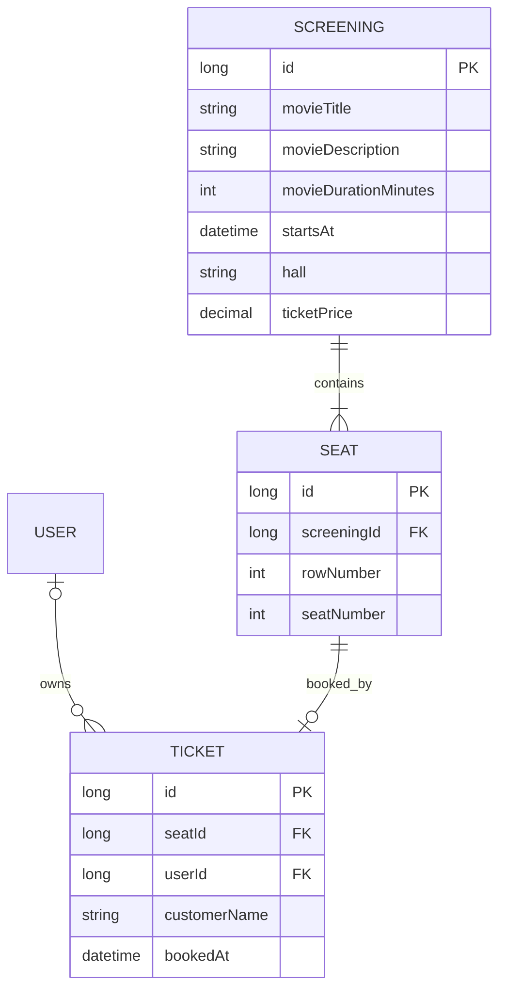

# AbsoluteSvinema — cinema ticket booking system

> An educational Spring Boot application for Labs 2–6.
> **Variant 6 from the Lab 2 assignment.** The goal is a small, understandable, working project that meets the laboratory requirements **without unnecessary features**.

## 1. Project topic and scope

**Variant 6 assignment:**

- **Entities in the assignment:** screening, seat.
- **Actors:** guest, registered user, administrator.
- **Guest:** views screenings and books tickets.
- **Administrator:** creates, edits, and deletes screening and ticket information.

The implemented models are `Screening`, `Seat`, `Ticket`, and `User`. Movie information belongs to a screening; no separate movie, payment, or hall entity is needed.

### MVP capabilities

1. Lists screenings (movie, time, hall, price).
2. Shows the seats for a screening and their availability.
3. Lets a guest book an available seat by providing a name.
4. Prevents booking the same seat twice.
5. Lets an administrator manage screenings and tickets through simple pages.
6. Supports registration, session-based login/logout, My Tickets, and cancellation of the current user’s own tickets.
7. Protects administration with the ADMIN role; registered users have the USER role.
8. Future stages add REST (Lab 4) and replace storage gradually: **in-memory (Labs 2–4) → JDBC (Lab 5) → JPA (Lab 6)**.

Authentication uses Spring Security sessions and BCrypt password hashing. Standard CSRF protection covers all POST forms through Thymeleaf integration. Guests can browse and book seats; only the owning user can cancel a ticket through My Tickets. Administrators can manage all screenings and tickets, including guest bookings.

**Out of scope:** payments, QR codes, email/SMS, complex frontend architecture, and production deployment hardening. Since Lab 5 data is stored in PostgreSQL (Docker Compose) and survives restarts.

## 2. Data models

| Model | Main fields | Purpose |
|---|---|---|
| `Screening` | `id`, `movieTitle`, `movieDescription`, `movieDurationMinutes`, `startsAt`, `hall`, `ticketPrice` | A screening of a particular movie |
| `Seat` | `id`, `screeningId`, `rowNumber`, `seatNumber` | A seat **in a particular screening** |
| `Ticket` | `id`, `seatId`, `userId` (nullable for guests), `customerName`, `bookedAt` | A booking for one seat |
| `User` | `id`, `email`, `password` (BCrypt hash), `fullName`, `role` | Registered account with USER or ADMIN access |

**Conventions:**

- Creating a screening automatically creates seats using a **fixed layout of 3 rows × 5 seats = 15 seats**. The constructor or service creates them once; no separate hall editor is needed.
- A seat is available when there is **no** ticket for its `seatId`. Do not store a separate `Seat.booked` flag: it duplicates state.
- **One ticket per seat.** Check in the service and, after migrating to a database, also enforce `UNIQUE(ticket.seat_id)`.
- Booking checks that the seat and screening exist. Rejecting bookings for past screenings can be added if needed.
- Price uses `BigDecimal`; date and time use `LocalDateTime`. Validate MVC and REST input with Jakarta Validation.
- For the MVP, editing a ticket means changing `customerName`; cancelling a booking means deleting the ticket. Do not implement moving tickets between seats.
- Deleting a screening must also remove its seats and tickets correctly (explicitly in Fake storage; through defined relationships/cascades or transactions in JDBC/JPA).

### Entity relationships



## 3. Technology and structure

**Name:** `AbsoluteSvinema` · **GitHub repo:** `AbsoluteSvinema` · **Maven artifactId:** `absolute-svinema` · **Java package:** `ua.kpi.absolutesvinema`.

**Foundation:** Java 21+ (the team should use the same JDK version), Spring Boot, Maven, Spring MVC, Thymeleaf, Spring Security, Jakarta Bean Validation, JUnit 5. Add springdoc-openapi for Lab 4; Spring JDBC and PostgreSQL for Lab 5; Spring Data JPA for Lab 6. Lombok is optional: agree on a style once and avoid spending time rewriting it.

```text
src/main/java/ua/kpi/absolutesvinema/
├── AbsoluteSvinemaApplication.java
├── model/                 Screening, Seat, Ticket, User
├── repository/            ScreeningRepository, SeatRepository, TicketRepository, UserRepository
│   └── memory/            InMemory...Repository (Labs 2–4)
├── service/               ScreeningService, TicketService, UserService
├── controller/            MVC controllers (Labs 2–3)
├── api/                   Planned REST controller and DTOs (Lab 4; not implemented)
├── config/                Spring configuration + DI/scope examples
└── exception/             Clear errors + HTTP handler

src/main/resources/
├── templates/             HTML + Thymeleaf
└── application.properties

src/test/java/ua/kpi/absolutesvinema/
docs/
├── lab-2/                 Screenshots and brief explanations
├── lab-3/
├── lab-4/
├── lab-5/
└── lab-6/
```

**Architecture:** `MVC / REST Controller → Service → Repository interface → implementation`. Controllers **must not access repositories directly**; HTML and REST share the same business logic. Avoid factory/strategy/mapper layers unless needed.

## 4. Responsibilities for five participants

**One participant per lab.** Labs 2–6 are five consecutive stages of one project. Fill in the names after agreeing on ownership.

| Participant | Responsibility | Handoff to the next participant |
|---|---|---|
| 1 — ______ | **Lab 2:** skeleton, models, Fake Repository, services, minimal MVC, DI | Working application and stable model/service methods |
| 2 — ______ | **Lab 3:** Thymeleaf pages, forms, XSS, MVC scenarios | Complete HTML interface over existing services |
| 3 — ______ | **Lab 4:** REST, CRUD, filtering, pagination, two PATCH formats, OpenAPI, Postman | Working API and example requests |
| 4 — ______ | **Lab 5:** PostgreSQL, JDBC, transactions | JDBC storage replacing Fake storage without changing service behavior |
| 5 — ______ | **Lab 6:** Spring Data JPA, relationships, queries, checks | JPA storage replacing JDBC without changing the external API |

> **Important:** stages depend on each other; these are **not five independent parallel projects**. While waiting, the next participant can read the assignment, prepare Postman scenarios or the report, but should not create an incompatible skeleton. Each participant defends the lab **individually**, so everyone should understand the code at least at a basic level.

### Minimal handoff checklist

Before handing a stage to the next participant, its owner:

1. Runs `./mvnw test` and `./mvnw spring-boot:run` (or `mvn` if the wrapper is unavailable).
2. Checks one successful and one failing scenario.
3. Opens a PR/merges into `main` after a brief review and adds a `lab-2`, `lab-3`, etc. tag.
4. Writes **3–5 sentences** in the PR: what changed, how to run it, what was checked, and known limitations.
5. Puts screenshots and materials for **one report per lab** in `docs/lab-N/`. The report includes a title page with all participants' names and groups, steps with screenshots and explanations, and answers to review questions. Agree with the instructor on who submits it.

No agent or Codex may **commit or push without a person's permission**.

## 5. Lab 2 — creating and connecting components (completed)

**The project foundation.** Exact requirements are taken from `Spring-lab-02(1).docx`.

### Implemented

- [x] Create a Spring Boot project with **Spring Web + Thymeleaf**; add Validation and Test for convenience.
- [x] Create `Screening`, `Seat`, `Ticket`, and repository interfaces.
- [x] Create **Fake Repositories** backed by `Map` with generated IDs; data stays in memory for now.
- [x] Implement `ScreeningService`: list/details, creation, editing, deletion, and automatic creation of 15 seats.
- [x] Implement `TicketService`: book an available seat, retrieve/edit/cancel a ticket, and prevent duplicate bookings.
- [x] Minimal `@Controller` + Thymeleaf: screening list and a simple booking form (complete pages come in Lab 3).
- [x] Demonstrate `@Component`, `@Repository`, `@Service`, `@Controller`.
- [x] Demonstrate **`@Bean` in `@Configuration`** (for example, a `Clock` bean).
- [x] Demonstrate **singleton and prototype**: a standard singleton service and a small prototype component (for example, `BookingDraft`). Prove through a test or demonstration that two prototype lookups return different instances. Do not build a separate architecture for this.
- [x] Demonstrate **three DI styles**: constructor (the main style in services), setter, and field (`@Autowired` in small demonstration components). Clearly show these examples during the defense.
- [x] Unit tests: screening creation, booking, duplicate booking, missing screening/seat.

**Completion criterion:** the application starts, screenings are visible, a seat can be booked, and there are concrete examples of all annotations, both scopes, and all three DI styles.

## 6. Lab 3 — template engines / MVC (completed)

**Extend Lab 2; do not create a new project.** Exact requirements are taken from `Spring-lab-03(1).docx`.

### Implemented

- [x] `/screenings`: a list of screenings with links to details.
- [x] `/screenings/{id}`: screening information and available/booked seats.
- [x] Booking form (`POST`), confirmation page or error message.
- [x] Simple administration pages at `/admin/screenings` (create/edit/delete) and `/admin/tickets` (list/rename/cancel).
- [x] Use each of the following **at least once** in templates: `th:if`, `th:unless`, Elvis `?:`, `th:switch` / `th:case`, `th:each`.
- [x] XSS: render user text (movie title, customer name) with **`th:text`**, not `th:utext`; check input such as `<script>alert(1)</script>`.
- [x] Simple error display and server-side form validation.
- [x] Spring Security: session login/logout, registration, BCrypt, USER/ADMIN authorization, user-owned tickets, and CSRF protection.

**Completion criterion:** the main scenario works in a browser; all Thymeleaf constructs appear in real templates, and an XSS string does not execute.

## 7. Lab 4 — RESTful web services (completed)

**The same project; REST added alongside MVC.** Detailed documentation, Postman workflow, and API map are available in [docs/lab-4/README.md](file:///D:/Java/spring/lab%202%203%204/docs/lab-4/README.md).

### Implemented

- [x] `ScreeningRestController` at `/api/screenings`:
  - `POST /api/screenings` — create (**201 Created** with `Location` header).
  - `GET /api/screenings/{id}` — read details (**200 OK / 404 Not Found**).
  - `GET /api/screenings` — list with **filtering** (`title`, `hall`) and **pagination** (`page`, `size`).
  - `PUT /api/screenings/{id}` — full update (**200 OK / 400 / 404**).
  - `DELETE /api/screenings/{id}` — delete with seats and tickets (**204 No Content / 404**).
- [x] Two standard partial update handlers (`PATCH /api/screenings/{id}`):
  - `application/json-patch+json` — **RFC 6902 JSON Patch** (array of operations: `add`, `remove`, `replace`, `move`, `copy`, `test`).
  - `application/merge-patch+json` — **RFC 7396 JSON Merge Patch** (JSON document patch; explicit `null` fails Bean Validation on required fields).
  - Atomic persistence: updates persist only after patch application and full Bean Validation succeed; invalid paths, unknown fields, or forbidden fields (`id`, `seats`) are rejected with 400.
- [x] Consistent HTTP error responses via `@RestControllerAdvice` (`ApiExceptionHandler`) returning RFC 7807 `ProblemDetail` (**400, 401, 403, 404, 409, 415**).
- [x] REST DTOs (`ScreeningRequest`, `ScreeningResponse`, `PageResponse`, `CsrfResponse`) with Jakarta Bean Validation and OpenAPI `@Schema`.
- [x] **OpenAPI 3 / Swagger UI** integration via `springdoc-openapi-starter-webmvc-ui:3.2.0`:
  - Swagger UI: `http://localhost:8080/swagger-ui.html`
  - OpenAPI JSON: `http://localhost:8080/v3/api-docs`
  - Grouped API (`/api/**`), operation summaries, descriptions, parameters, schemas, and security schemes (`cookieAuth`, `csrfToken`).
- [x] **Postman Collection v2.1** under `docs/lab-4/postman/AbsoluteSvinema-Lab4.postman_collection.json` containing 33 structured requests covering auth, CRUD, pagination, filtering, both PATCH formats, error cases, and documentation endpoints.

**Completion criterion:** REST works independently of HTML using the same underlying services; both PATCH formats work correctly without breaking invariants; Postman collection imports cleanly and matches OpenAPI contracts.

## 8. Lab 5 — Docker, JDBC and PostgreSQL (completed)

Setup, schema, transaction/rollback demonstration and verification results: [docs/lab-5/README.md](docs/lab-5/README.md).

- [x] `Dockerfile` + `compose.yaml` (app + `postgres:17-alpine` with a named volume and healthcheck); secrets in a local `.env` (template: `.env.example`).
- [x] `schema.sql`: `screenings`, `seats`, `users`, `tickets` with identity PKs, FKs, `UNIQUE(tickets.seat_id)`, `UNIQUE(users.email)`.
- [x] JDBC repositories **without changing controllers or the service business API**: `JdbcTemplate` (screenings, seats) and `JdbcClient` (tickets, users), each with CRUD and criteria search.
- [x] `@Transactional` `ScreeningService.create` / `delete`; rollback verified after a partial SQL write.
- [x] `PasswordEncoder` uses `PASSWORD_SALT` from `.env` as a pepper on top of BCrypt.
- [x] Tests on in-memory H2 (PostgreSQL mode); manual checks on PostgreSQL in Docker.

**Completion criterion:** data survives application restarts, and Lab 2–4 scenarios continue to work.

## 9. Lab 6 — Spring Data JPA (completed)

The existing MVC/REST contracts now have an opt-in JPA/Hibernate repository implementation with entity relationships, `CrudRepository`, derived/JPQL/named queries, and transaction tests. Setup, schema mapping, API scenarios, SQL inspection, and verification evidence: [docs/lab-6/README.md](docs/lab-6/README.md).

- [x] `@Entity` mappings exist for Screening, Seat, Ticket, and User; the Lab 5 SQL schema is unchanged.
- [x] The `ScreeningEntity @OneToMany SeatEntity` and `SeatEntity @ManyToOne ScreeningEntity` relationship works in an integration test.
- [x] PostgreSQL generated the screening ID, returned by the create request; screening creation and its 15 seats were verified against Docker PostgreSQL.
- [x] Four Spring Data `CrudRepository` interfaces and CRUD adapters are present.
- [x] JPQL `@Query` executes against H2 data, including literal `%` and `_` searches.
- [x] JPQL `@NamedQuery` executes against H2 data.
- [x] Derived query methods execute against H2 data.
- [x] Existing domain repository interfaces are preserved; the `jpa` profile activates the JPA adapters.
- [x] Default/JDBC and `memory` modes were checked for competing repository beans.
- [x] `ScreeningService.create()` commits one screening and exactly 15 seats to the H2 database.
- [x] A test injects a failure after seven seat inserts; rollback removes the screening and all partial seat rows.
- [x] Deletion was verified for linked tickets, seats, and screenings.
- [x] Guest tickets with `user_id IS NULL` and tickets linked to registered users were verified.
- [x] Guest booking and duplicate booking were checked over HTTP in JPA mode; a duplicate does not create a second ticket or return 500.
- [x] REST CRUD, filtering, pagination, and both PATCH formats were checked with `curl` in JPA mode against Docker PostgreSQL.
- [x] OpenAPI annotations describe parameters, request/response bodies, operations, and HTTP status codes; the OpenAPI integration test passed.
- [x] Manual HTTP verification was recorded through `curl`; rollback was verified separately by an integration test. Postman was not used.
- [x] `.env` and `PASSWORD_SALT` were not added to documentation or Git; Lab 2–5 files were not changed.

JPA startup, schema validation, and the reported `curl` scenarios were completed against Docker PostgreSQL. The rollback test ran separately against the configured test database. Detailed scenarios and SQL: [docs/lab-6/README.md](docs/lab-6/README.md).

### Opt-in JPA profile (setup commit)

The existing default remains JDBC. To start the Compose app in JPA mode, add `SPRING_PROFILES_ACTIVE=jpa` to your local, git-ignored `.env` and run `docker compose up --build -d`. For a locally run Spring Boot process, use `SPRING_PROFILES_ACTIVE=jpa ./mvnw spring-boot:run` after starting the database with `docker compose up -d db`. Keep your existing database credentials and `PASSWORD_SALT` in `.env`; do not put secrets in commands or source control. The JPA profile validates the existing schema and does not run `schema.sql`.

## 10. Scenarios that must always work

1. Create a screening → obtain its ID → see 15 seats.
2. Open the screening list → view a particular screening.
3. Book a seat → obtain a ticket → see the seat as booked.
4. Try to book the same seat again → receive a clear error.
5. Change a ticket's customer name / cancel a ticket → the seat becomes available after cancellation.
6. Update or delete a screening → leave no invalid related data.
7. For Lab 4: exercise all REST operations, filters, pagination, both PATCH formats, and errors.
8. For Labs 5–6: restart the application and check persistence and relationship integrity.

## 11. Getting started

Requires Docker (Compose v2); JDK 21+ only for running tests or the app outside Docker. From the repository root:

```sh
cp .env.example .env            # then set your own DB_PASSWORD and PASSWORD_SALT
docker compose up --build -d    # PostgreSQL + application
./mvnw test                     # tests use in-memory H2, no Docker needed
```

To run Spring Boot from the IDE/Maven instead: `docker compose up -d db` and `./mvnw spring-boot:run`. Details and the `docker compose down -v` data-loss warning: [docs/lab-5/README.md](docs/lab-5/README.md).

Open `http://localhost:8080`. Demo movies are **Interstellar**, **Pulp Fiction**, and **The Lord of the Rings: The Return of the King**. Each screening has 15 seats.

Demo accounts: `user@svinema.ua` / `user123` (USER), `admin@svinema.ua` / `admin123` (ADMIN). These are educational credentials.

| Routes | Access / behavior |
|---|---|
| `GET /`, `/screenings`, `/screenings/{id}` | Public home, listing, details |
| `POST /screenings/{id}/book` | Guest or authenticated seat booking |
| `GET /login`, `POST /login`, `GET /register`, `POST /register` | Public authentication and registration |
| `POST /logout` | End the current session |
| `GET /tickets/my`, `POST /tickets/{id}/cancel` | Authenticated user's tickets; cancellation requires ownership |
| `GET /admin/screenings`, `/admin/screenings/new`, `/admin/screenings/{id}/edit` | ADMIN screening pages |
| `POST /admin/screenings`, `/admin/screenings/{id}/edit`, `/admin/screenings/{id}/delete` | ADMIN screening management |
| `GET /admin/tickets`, `/admin/tickets/{id}/edit` | ADMIN ticket pages |
| `POST /admin/tickets/{id}/edit`, `/admin/tickets/{id}/cancel` | ADMIN ticket management |

All POST requests require a valid CSRF token and matching session cookie. Static CSS and JavaScript remain public. Labs 2–6 are documented in `docs/lab-N/`; store each lab's report evidence in its matching directory.

### Rule for Codex / AI assistants

> Implement **only the current lab** according to this README and its assignment. Prioritize **the simplest correct solution** covering all mandatory requirements. Do not add unnecessary entities, endpoints, complex abstractions, or future-lab features. Preserve the main business scenarios and compatibility with completed stages. Run tests, list changed files, and report results at the end. **Do not run git add/commit/push without a separate instruction.**

---

**Project philosophy:** *small, complete, understandable*. This should be a good educational Spring project, not an imitation of a large commercial cinema.
