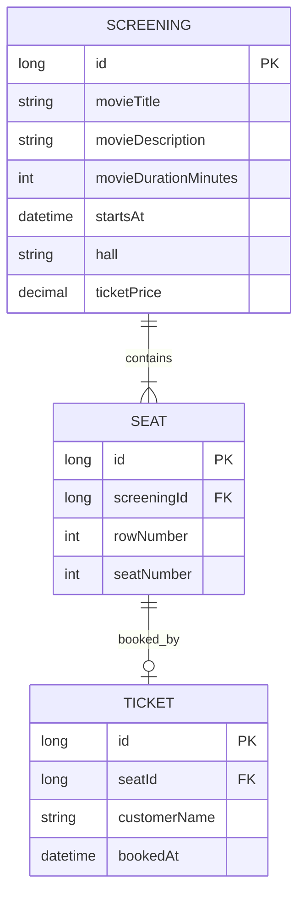

# AbsoluteSvinema — cinema ticket booking system

> An educational Spring Boot application for Labs 2–6.
> **Variant 6 from the Lab 2 assignment.** The goal is a small, understandable, working project that meets the laboratory requirements **without unnecessary features**.

## 1. Project topic and scope

**Variant 6 assignment:**

- **Entities in the assignment:** screening, seat.
- **Actors:** guest, administrator.
- **Guest:** views screenings and books tickets.
- **Administrator:** creates, edits, and deletes screening and ticket information.

We introduce a **ticket** as a third simple model to represent a booking. Do not create separate `Movie`, `User`, `Payment`, `CinemaHall`, `Order`, `Role`, or similar entities: they are unnecessary for this educational task.

### MVP capabilities

1. Lists screenings (movie, time, hall, price).
2. Shows the seats for a screening and their availability.
3. Lets a guest book an available seat by providing a name.
4. Prevents booking the same seat twice.
5. Lets an administrator manage screenings and tickets through simple pages.
6. Provides the screening REST API capabilities required by Lab 4.
7. Replaces storage gradually: **in-memory (Labs 2–4) → JDBC (Lab 5) → JPA (Lab 6)**.

**Out of scope:** registration, authentication, authorization, payments, QR codes, email/SMS, personal accounts, database roles, interactive JavaScript seat maps, microservices, mandatory Docker/Kubernetes, and a complex frontend. The `/admin/**` pages are educational and **have no access protection**; the Lab 3–4 assignments allow this. Do not describe this solution as production-ready.

## 2. Data models

| Model | Main fields | Purpose |
|---|---|---|
| `Screening` | `id`, `movieTitle`, `movieDescription`, `movieDurationMinutes`, `startsAt`, `hall`, `ticketPrice` | A screening of a particular movie |
| `Seat` | `id`, `screeningId`, `rowNumber`, `seatNumber` | A seat **in a particular screening** |
| `Ticket` | `id`, `seatId`, `customerName`, `bookedAt` | A booking for one seat |

**Conventions:**

- Creating a screening automatically creates seats using a **fixed layout of 3 rows × 5 seats = 15 seats**. The constructor or service creates them once; no separate hall editor is needed.
- A seat is available when there is **no** ticket for its `seatId`. Do not store a separate `Seat.booked` flag: it duplicates state.
- **One ticket per seat.** Check in the service and, after migrating to a database, also enforce `UNIQUE(ticket.seat_id)`.
- Booking checks that the seat and screening exist. Rejecting bookings for past screenings can be added if needed.
- Price uses `BigDecimal`; date and time use `LocalDateTime`. Validate MVC and REST input with Jakarta Validation.
- For the MVP, editing a ticket means changing `customerName`; cancelling a booking means deleting the ticket. Do not implement moving tickets between seats.
- Deleting a screening must also remove its seats and tickets correctly (explicitly in Fake storage; through defined relationships/cascades or transactions in JDBC/JPA).

### Entity relationships



## 3. Technology and structure

**Name:** `AbsoluteSvinema` · **GitHub repo:** `AbsoluteSvinema` · **Maven artifactId:** `absolute-svinema` · **Java package:** `ua.kpi.absolutesvinema`.

**Foundation:** Java 21+ (the team should use the same JDK version), Spring Boot, Maven, Spring Web, Thymeleaf, Jakarta Bean Validation, JUnit 5. Add springdoc-openapi for Lab 4; Spring JDBC and PostgreSQL for Lab 5; Spring Data JPA for Lab 6. Lombok is optional: agree on a style once and avoid spending time rewriting it.

```text
src/main/java/ua/kpi/absolutesvinema/
├── AbsoluteSvinemaApplication.java
├── model/                 Screening, Seat, Ticket
├── repository/            ScreeningRepository, SeatRepository, TicketRepository
│   └── memory/            InMemory...Repository (Labs 2–4)
├── service/               ScreeningService, TicketService
├── controller/            MVC controllers (Labs 2–3)
├── api/                   REST controller, request/response DTOs (Lab 4)
├── config/                Spring configuration + DI/scope examples
└── exception/             Clear errors + HTTP handler

src/main/resources/
├── templates/             HTML + Thymeleaf
└── application.properties

src/test/java/ua/kpi/absolutesvinema/
docs/
├── lab-2/                 Screenshots and brief explanations
├── lab-3/
├── lab-4/
├── lab-5/
└── lab-6/
```

**Architecture:** `MVC / REST Controller → Service → Repository interface → implementation`. Controllers **must not access repositories directly**; HTML and REST share the same business logic. Avoid factory/strategy/mapper layers unless needed.

## 4. Responsibilities for five participants

**One participant per lab.** Labs 2–6 are five consecutive stages of one project. Fill in the names after agreeing on ownership.

| Participant | Responsibility | Handoff to the next participant |
|---|---|---|
| 1 — ______ | **Lab 2:** skeleton, models, Fake Repository, services, minimal MVC, DI | Working application and stable model/service methods |
| 2 — ______ | **Lab 3:** Thymeleaf pages, forms, XSS, MVC scenarios | Complete HTML interface over existing services |
| 3 — ______ | **Lab 4:** REST, CRUD, filtering, pagination, two PATCH formats, OpenAPI, Postman | Working API and example requests |
| 4 — ______ | **Lab 5:** PostgreSQL, JDBC, transactions | JDBC storage replacing Fake storage without changing service behavior |
| 5 — ______ | **Lab 6:** Spring Data JPA, relationships, queries, checks | JPA storage replacing JDBC without changing the external API |

> **Important:** stages depend on each other; these are **not five independent parallel projects**. While waiting, the next participant can read the assignment, prepare Postman scenarios or the report, but should not create an incompatible skeleton. Each participant defends the lab **individually**, so everyone should understand the code at least at a basic level.

### Minimal handoff checklist

Before handing a stage to the next participant, its owner:

1. Runs `./mvnw test` and `./mvnw spring-boot:run` (or `mvn` if the wrapper is unavailable).
2. Checks one successful and one failing scenario.
3. Opens a PR/merges into `main` after a brief review and adds a `lab-2`, `lab-3`, etc. tag.
4. Writes **3–5 sentences** in the PR: what changed, how to run it, what was checked, and known limitations.
5. Puts screenshots and materials for **one report per lab** in `docs/lab-N/`. The report includes a title page with all participants' names and groups, steps with screenshots and explanations, and answers to review questions. Agree with the instructor on who submits it.

No agent or Codex may **commit or push without a person's permission**.

## 5. Lab 2 — creating and connecting components

**The project foundation.** Exact requirements are taken from `Spring-lab-02(1).docx`.

### Implement

- [ ] Create a Spring Boot project with **Spring Web + Thymeleaf**; add Validation and Test for convenience.
- [ ] Create `Screening`, `Seat`, `Ticket`, and repository interfaces.
- [ ] Create **Fake Repositories** backed by `Map` with generated IDs; data stays in memory for now.
- [ ] Implement `ScreeningService`: list/details, creation, editing, deletion, and automatic creation of 15 seats.
- [ ] Implement `TicketService`: book an available seat, retrieve/edit/cancel a ticket, and prevent duplicate bookings.
- [ ] Minimal `@Controller` + Thymeleaf: screening list and a simple booking form (complete pages come in Lab 3).
- [ ] Demonstrate `@Component`, `@Repository`, `@Service`, `@Controller`.
- [ ] Demonstrate **`@Bean` in `@Configuration`** (for example, a `Clock` bean).
- [ ] Demonstrate **singleton and prototype**: a standard singleton service and a small prototype component (for example, `BookingDraft`). Prove through a test or demonstration that two prototype lookups return different instances. Do not build a separate architecture for this.
- [ ] Demonstrate **three DI styles**: constructor (the main style in services), setter, and field (`@Autowired` in small demonstration components). Clearly show these examples during the defense.
- [ ] Unit tests: screening creation, booking, duplicate booking, missing screening/seat.

**Completion criterion:** the application starts, screenings are visible, a seat can be booked, and there are concrete examples of all annotations, both scopes, and all three DI styles.

## 6. Lab 3 — template engines / MVC

**Extend Lab 2; do not create a new project.** Exact requirements are taken from `Spring-lab-03(1).docx`.

### Implement

- [ ] `/screenings`: a list of screenings with links to details.
- [ ] `/screenings/{id}`: screening information and available/booked seats.
- [ ] Booking form (`POST`), confirmation page or error message.
- [ ] Simple administration pages at `/admin/screenings` (create/edit/delete) and `/admin/tickets` (list/rename/cancel).
- [ ] Use each of the following **at least once** in templates: `th:if`, `th:unless`, Elvis `?:`, `th:switch` / `th:case`, `th:each`.
- [ ] XSS: render user text (movie title, customer name) with **`th:text`**, not `th:utext`; check input such as `<script>alert(1)</script>`.
- [ ] Simple error display and server-side form validation.
- [ ] **No Spring Security**: this lab does not require authentication or authorization.

**Completion criterion:** the main scenario works in a browser; all Thymeleaf constructs appear in real templates, and an XSS string does not execute.

## 7. Lab 4 — RESTful web services

**The same project; add REST alongside MVC.** Exact requirements are taken from `Spring-lab-04(1).docx`.

### Implement

- [ ] `ScreeningRestController` at `/api/screenings`:
  - `POST /api/screenings` — create (**201**).
  - `GET /api/screenings/{id}` — read (**200 / 404**).
  - `GET /api/screenings` — list with **filtering** (for example, `movieTitle`) and **pagination** (`page`, `size`).
  - `PUT /api/screenings/{id}` — fully update (**200 / 400 / 404**).
  - `DELETE /api/screenings/{id}` — delete (**204 / 404**).
- [ ] Two **different** `PATCH /api/screenings/{id}` formats selected by `Content-Type`:
  - `application/json-patch+json` — **JSON Patch, RFC 6902** (an array of operations).
  - `application/merge-patch+json` — **JSON Merge Patch, RFC 7386** (a JSON object).
  - Use correct support for these formats; **do not present an ordinary partial PUT as an implementation of both RFCs**. Patch only permitted screening fields and validate the result.
- [ ] Correct HTTP codes, including **400, 404, 409** where appropriate, and clear JSON errors (`@RestControllerAdvice`).
- [ ] REST request/response DTOs, `@Valid`, and Jakarta Validation; avoid returning mutable domain objects directly if that causes problems.
- [ ] **OpenAPI for every operation**: summary, description, parameters/data models, and all expected HTTP statuses.
- [ ] Check the API in **Postman** against its documentation: CRUD, filters, pagination, both PATCH formats, and errors; save the collection/screenshots.

**Completion criterion:** REST works independently of HTML and uses **the same services**; Postman examples match OpenAPI.

## 8. Lab 5 — JDBC and PostgreSQL (preliminary plan)

> **Note:** the exact Lab 5 assignment has not yet been incorporated into this README. This is the agreed technical plan; check mandatory requirements against the original assignment before implementation.

- [ ] Connect PostgreSQL and create `screenings`, `seats`, `tickets` tables with PK/FK and `UNIQUE(tickets.seat_id)`.
- [ ] Replace Fake Repositories with JDBC implementations **without changing controllers or the service business API**.
- [ ] Demonstrate **`JdbcTemplate` and `JdbcClient`** in real CRUD/search operations if required by the assignment.
- [ ] Database-generated IDs and correct reading of lists and relationships.
- [ ] `@Transactional` for creating/deleting a screening together with its seats, or another compound operation; verify **rollback** on error.
- [ ] Storage tests using a real test database / reproducible SQL demonstrations.

**Completion criterion:** data survives application restarts, and Lab 2–4 scenarios continue to work.

## 9. Lab 6 — Spring Data JPA (preliminary plan)

> **Note:** the exact Lab 6 assignment still needs to be checked. Do not treat this list as the instructor's verbatim requirements.

- [ ] Migrate to Spring Data JPA / Hibernate without rewriting MVC or REST.
- [ ] `@Entity`, `@Id`, `@GeneratedValue`, Spring Data `CrudRepository` (or `JpaRepository` if allowed).
- [ ] Demonstrate **1:N** for `Screening → Seat`; handle tickets correctly.
- [ ] Three query styles if required: **derived query methods**, JPQL **`@Query`**, **`@NamedQuery`** (for example, searches by movie/time and tickets for a screening).
- [ ] Check transactions, creation, reads, updates, deletion, and double-booking prevention.
- [ ] Verify that HTML and REST from Labs 2–4 still work after replacing storage.

**Completion criterion:** the same functionality works on JPA; queries and entity relationships are demonstrated in code and tests.

## 10. Scenarios that must always work

1. Create a screening → obtain its ID → see 15 seats.
2. Open the screening list → view a particular screening.
3. Book a seat → obtain a ticket → see the seat as booked.
4. Try to book the same seat again → receive a clear error.
5. Change a ticket's customer name / cancel a ticket → the seat becomes available after cancellation.
6. Update or delete a screening → leave no invalid related data.
7. For Lab 4: exercise all REST operations, filters, pagination, both PATCH formats, and errors.
8. For Labs 5–6: restart the application and check persistence and relationship integrity.

## 11. Getting started

1. Create a **new small repository**, `AbsoluteSvinema`, instead of copying the entire old BlindPig project.
2. In Spring Initializr, select Maven, Java, Spring Web, Thymeleaf, Validation, and Spring Boot Starter Test (or the corresponding starters for your version).
3. Add this README to the repository root.
4. **Participant 1** implements only **Lab 2**; the others should not change that participant's files yet.
5. After successful `mvn test` and a manual startup: review, merge, `lab-2` tag, and handoff to participant 2. Repeat for Labs 3 → 4 → 5 → 6.
6. Prepare a separate report **for each lab** according to the instructor's requirements; store evidence in `docs/lab-N/`.

### Rule for Codex / AI assistants

> Implement **only the current lab** according to this README and its assignment. Prioritize **the simplest correct solution** covering all mandatory requirements. Do not add unnecessary entities, endpoints, authentication, complex abstractions, or future-lab features. Preserve the main business scenarios and compatibility with completed stages. Run tests, list changed files, and report results at the end. **Do not run git add/commit/push without a separate instruction.**

---

**Project philosophy:** *small, complete, understandable*. This should be a good educational Spring project, not an imitation of a large commercial cinema.
